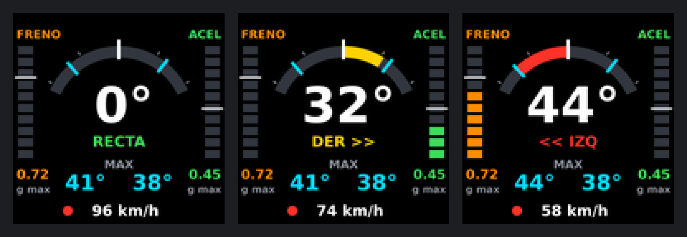

# Uso

## Botones

Se identifican por el color de la serigrafía de la placa.

| Botón | Pulsación | Acción |
|---|---|---|
| Azul (IO0) | Mantener 3 s | Iniciar la calibración |
| Naranja (IO47) | Mantener 1,5 s | Borrar los máximos |
| Naranja (IO47) | Corta | Confirmar cada paso de la calibración |
| Verde (IO48) | Corta | Girar la pantalla 90° (queda guardado) |
| Verde (IO48) | Mantener 1,5 s | Terminar la ruta y parar la grabación; otra vez para reanudarla |

Durante la calibración, una pulsación corta del botón azul la cancela.

## Calibración

Se hace **una vez, con la placa ya fijada en la moto**, y se repite solo si se cambia de sitio.

1. Mantén el botón azul 3 s.
2. **Paso 1/2**: pon la moto **recta y quieta** (en el caballete central o sujetándola vertical) y pulsa naranja.
3. **Paso 2/2**: apóyala en la **pata de cabra** y pulsa naranja.

Con las dos posiciones el aparato deduce dónde está "arriba" y hacia dónde es "delante", sea cual sea la orientación de la placa. Se da por hecho que la pata de cabra está a la **izquierda**.

Si entre los dos pasos hay menos de unos 4° de diferencia aparece "ERROR – Poca diferencia" y hay que repetir.

## Pantalla

| Elemento | Significado |
|---|---|
| Arco superior | Inclinación actual, desde el centro hacia el lado al que se tumba. Fondo de escala ±65° |
| Marcas cian en el arco | Máxima inclinación alcanzada a cada lado |
| Número grande | Inclinación actual en grados |
| MAX | Máxima a la izquierda y a la derecha |
| Barra izquierda (FRENO) | Frenada en directo; cada segmento es 0,1 g. La raya blanca es el máximo |
| Barra derecha (ACEL) | Aceleración en directo, igual que la anterior |
| Cifra inferior | Velocidad GPS en km/h, o «sin GPS». Un punto rojo al lado indica que se está grabando la ruta |

## Web

Las páginas de la placa y la del mapa se explican en [WEB.md](WEB.md). Para entrar desde el móvil:

1. Conéctate a la WiFi **`MotoLean`**. La clave de fábrica es `moto1234`.
2. Abre <http://192.168.4.1> en el navegador. Pide usuario y clave: el usuario es **`moto`** y la clave, la misma de la WiFi.
3. La primera vez, la web solo deja **cambiar la clave**. La de fábrica la conoce cualquiera, así que hasta cambiarla no se puede usar nada más. Al guardarla, la placa se reinicia y hay que volver a conectarse con la clave nueva.

La página muestra los mismos datos en directo y tiene un botón para borrar los máximos.

### Si olvidas la clave

1. Enciende la placa.
2. En cuanto se ilumine la pantalla (pone «Arrancando...»), mantén pulsado el botón **BOOT** (placa 1,69") o **AZUL** (placa LOLIN) durante 3 s.
3. La pantalla muestra «CLAVE WIFI de fábrica: moto1234». Suelta el botón.

No lo pulses antes de encender: con ese botón pulsado al dar corriente, la placa entra en modo de carga de firmware y la pantalla se queda apagada.

## Qué se guarda

| Dato | Cuándo |
|---|---|
| Calibración | Al terminarla |
| Giro de pantalla | Al cambiarlo |
| Máximos | Automáticamente, como mucho cada 5 s y solo si han cambiado |
